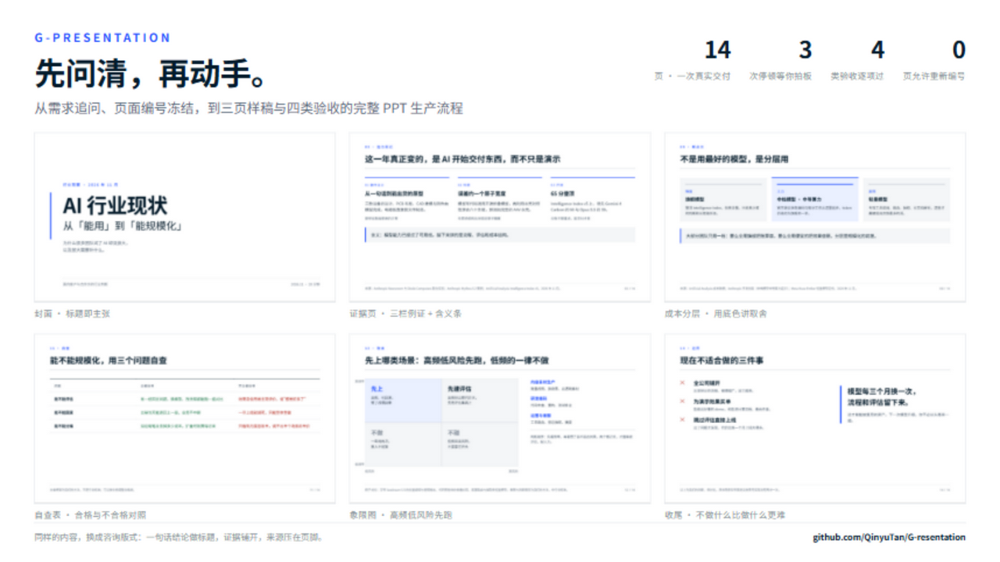
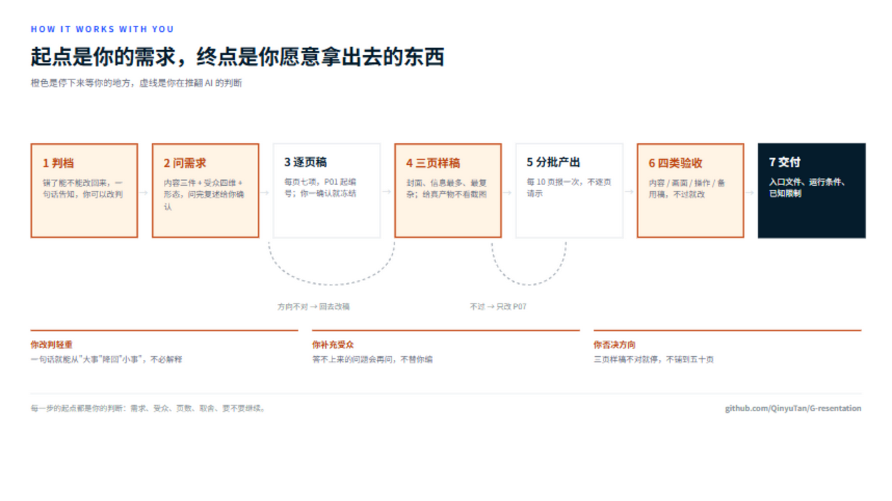
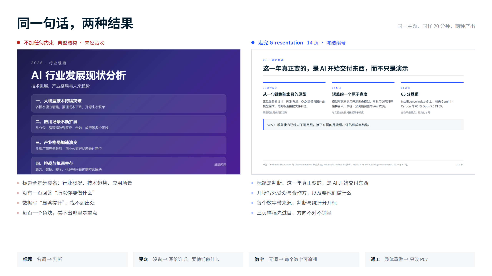
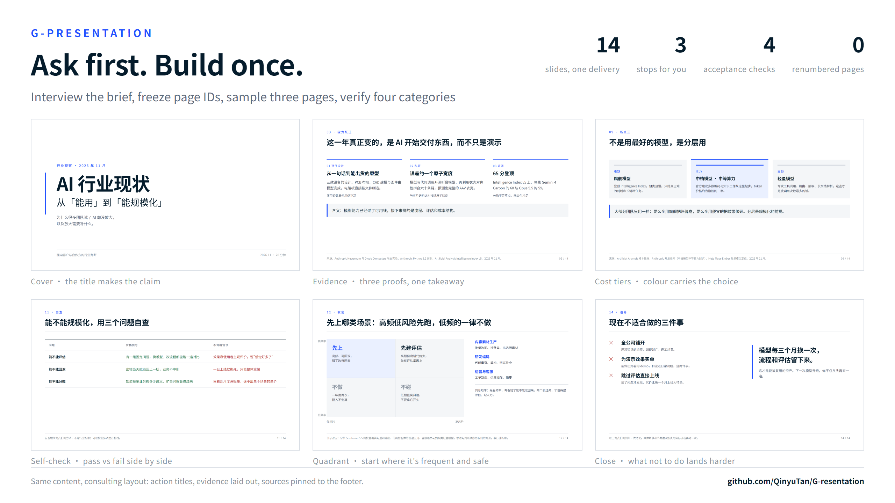
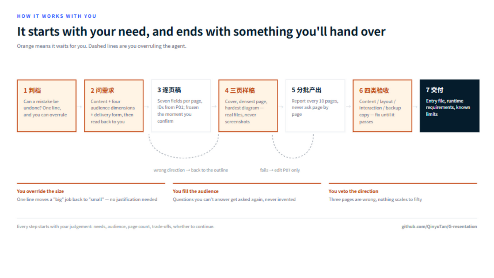
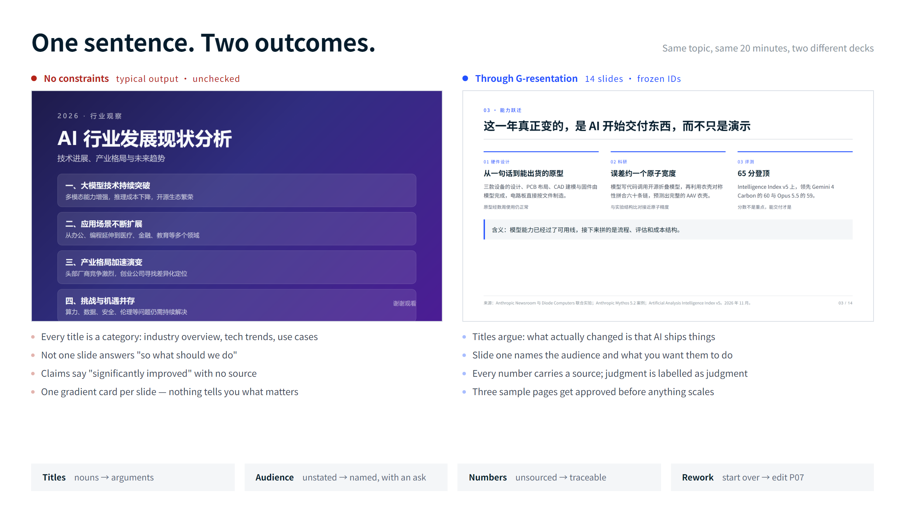
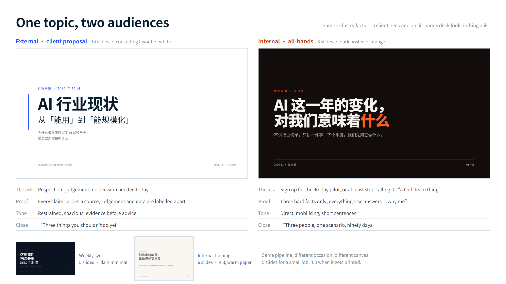

# G-resentation

**做砸的 PPT，问题通常不在排版，在于没人问清楚这份东西给谁看、听完要他们做什么。**

G-resentation 在你的 AI 动手之前先拦住它，把需求问到说不出含糊话，再把页码锁死、把活分给合适的工具、最后按清单验收。名字来自 grill me in presentation。

它不是又一个"输入主题、输出幻灯片"的生成器。它管的是从空白到交得出手之间那段最容易返工的路。



## 它怎么跟你配合

这张图里，橙色的方块全部是停下来等你的地方，虚线是你在推翻 AI 的判断。



**起点是你的一句话，终点是你愿意拿出去的东西。** 中间每一次停顿，都是把决策权交回给你：判档你可以改判，需求你可以补，逐页稿你可以删页，样稿你可以否决方向，验收不过就改到过。AI 只负责问、编排和记录，不替你决定这份东西讲给谁听。

这套顺序不是凭空设计的。三年多的咨询与研究项目里，返工几乎从不发生在排版上，而是发生在"没人问清楚"那一步：讲给谁、听完要做什么、哪些数字有出处。所以流程把检查点放在这三个位置，而不是放在最后的美化环节。

## 它解决的问题

一句话丢给 AI："帮我做个 PPT。"你会拿到四十页，结构是新闻稿式的，每一页都在介绍，没有一页在说服。改到第三版，已经不像你要的东西了。

这不是模型笨。是你没说给谁看、什么场合、听完要他们干什么，AI 只能按平均水平补。补出来的东西，谁也不得罪，也就谁也不打动。

G-resentation 的做法很朴素：**先问，再锁，后做，最后验。**

## 同一句话，两种结果



左边不是被刻意做丑的，它是不加约束时最省事的输出形态：标题是分类名，每页都正确，也每页都不推动任何决定。右边是同一主题走完流程的第十三页——标题是判断，数字有出处，页脚写清来源。

需要说明的是：左图是代表性示意，不是某一次具体生成结果的逐字复刻；右图是真实产出的一页。

## 五个停顿

| 停顿 | 你做什么 | 它做什么 |
|---|---|---|
| 判档 | 说一句"这是对外评审"或"内部周会" | 按"错了能不能改回来"分大小活，一句话告知，你可以改判 |
| 问需求 | 回答 8–12 个问题，或者填一张表 | 小事给表，大事一次一问：内容三件事、受众四个维度、交付形态 |
| 定结构 | 看逐页稿，改想要的页 | 每页七项写死（观点、文字、数据来源、素材、布局、备注），编号 P01 起 |
| 看样稿 | 看三页真产物 | 只做最难的三页：封面、信息最多、图表最复杂。网页给能翻的 HTML，图给原始分辨率 PNG，PPTX 给能打开的文件 |
| 验收 | 最后通读一遍 | 内容、画面、操作、备用稿四类逐项过，网页版真开浏览器跑 |

中间只报进度，不逐页请示。一个五十页的活停五十次，三天后你就烦了，最后还是全丢给 AI。

## 两件别人没做的事

**页码冻结。** 逐页稿确认后立刻存基线，P01 就是第一页，增删页必须你点头。附带的脚本会拿当前稿和基线比对——偷偷加一页，当场抓出来。这样"改 P07"永远指得准。

**只认真产物。** 样稿阶段不接受截图。截图看不出缩放溢出、看不出动画卡顿、看不出字被挡住。要么给能打开的文件，要么别说做完了。

## 四份真样例


同一份行业事实，讲给客户和讲给同事，结构完全不同：对外先给判断、每条带出处、收尾讲"不该做什么"；对内只留三条硬事实，其余换成"关我什么事"，收尾是"三个人，一个场景"。

| 样例 | 场合 | 版式 | 页数 |
|---|---|---|---|
| [客户提案](samples/client-proposal/) | 会后发 PDF | 咨询版式，白底蓝调 | 14 |
| [全员宣讲](samples/internal-briefing/) | 现场招募试点 | 深色大字报，橙调 | 8 |
| [内部培训](samples/training/) | 要打印讲义 | 米色教学，4:3 画布 | 6 |
| [部门周会](samples/weekly-sync/) | 小事档，填表就走 | 深色极简 | 5 |

每份都带 `brief.md` 和 `outline.md`，双击目录里的 `index.html` 就能翻页。差别不在配色——同样一句"做个 AI 行业现状"，换受众之后，标题怎么起、证据放几页、最后一句说什么，全都变了。

## 安装

一条命令，装到全局：

```bash
npx skills add QinyuTan/G-resentation --skill g-resentation -g -y
```

不想用 npx，手动也行，需要 Python 3.10+（技能本身零依赖，只用标准库）：

```bash
git clone https://github.com/QinyuTan/G-resentation.git
cp -r G-resentation/skills/g-resentation ~/.agents/skills/
```

其他 agent 平台的技能目录见各自的文档；`SKILL.md` 的位置就是技能目录。装完跑一次自检，它会告诉你缺什么、下一步敲什么：

```bash
python3 ~/.agents/skills/g-resentation/scripts/doctor.py
```

四个制作工具是可选的，按你选的路线装，缺了就自动降级：

| 工具 | 用途 | 没装怎么办 |
|---|---|---|
| [frontend-slides](https://github.com/) | HTML 演示 | 手写单文件 HTML |
| guizang-ppt | HTML 演示的另一种风格 | 用 frontend-slides 顶上 |
| [ppt-master](https://github.com/hugohe3/ppt-master) | 可编辑 PPTX | 退到 HTML 或出图 |
| imagegen | 整页出图 | HTML 截图导 PNG |

## 五分钟上手

```bash
# 1. 自检，告诉你缺什么、下一步敲什么
python3 skills/g-resentation/scripts/doctor.py

# 2. 建一份材料
python3 skills/g-resentation/scripts/new_deck.py my-deck --title "我的第一份材料"

# 3. 填需求，然后出逐页稿、跑机检
python3 skills/g-resentation/scripts/check_outline.py decks/my-deck

# 4. 确认后冻结，存基线
python3 skills/g-resentation/scripts/snapshot.py decks/my-deck outline

# 5. 出三页样稿，方向对了再放量
```

详细步骤、每步的预期输出、六种常见报错怎么修，见 [QUICKSTART.md](skills/g-resentation/QUICKSTART.md)。

想先看一份填好的：`skills/g-resentation/examples/minimal/`，五页通用题材，可以直接跑机检。

## 里面有什么

```
skills/g-resentation/
├── SKILL.md              主线七步、边界、硬规则
├── QUICKSTART.md         五分钟五步 + 卡点表
├── references/
│   ├── step0.md          分档判据、表格字段、受众四维、逐页稿格式
│   ├── prompts.md        七条按步骤编号的提示词（P1–P7）
│   ├── paths.md          三条路的判据、各路线调用要点
│   └── checklist.md      四类验收、留版时机、交付说明
├── assets/               需求说明与逐页稿空表
├── examples/minimal/     填好的五页示例
└── scripts/
    ├── doctor.py         首次使用自检
    ├── new_deck.py       建项目夹
    ├── check_outline.py  页码连号、字段完整性、与冻结基线比对
    └── snapshot.py       留版
```

仓库根目录另有 `samples/`：四份完整样例（客户提案、全员宣讲、内部培训、部门周会），每份都带 `brief.md` 与 `outline.md`，可以直接打开看。

## 它不做的事

- 已有逐页大纲只求排版、只要美化、只改一页、只转格式——直接交给制作工具，不用走这套流程
- 不替你做设计判断：风格由制作环节决定，有参考图就给参考图
- 不替你编内容：资料冲突或缺失时它会停下来问，不会猜一个数字填上去
- 不打包任何第三方工具

## 现状

v0.1.0。流程、脚本、提示词都跑通过一份十四页的客户材料（那份材料不在仓库里）。真正的限制是：只有一份真实材料验证过，场景还窄。用着不对劲的地方，欢迎开 issue 说清楚你当时在做什么。

## License

MIT，见 [LICENSE](LICENSE)。

---

## English

**Most bad decks don't fail on layout. They fail because nobody asked who the deck is for and what the audience should do afterwards.**

G-resentation (from *grill me in presentation*) stops your agent before it starts generating. It interviews you until the brief is unambiguous, freezes the page numbers, routes the build to the right tool, and checks the result against a fixed list.



**How it works with you.** Every orange box below is a place where it stops and waits for your call. Every dashed arrow is you overruling the agent.



The input is one sentence from you; the output is something you're willing to hand over. The agent asks, routes, and records — it does not decide who the deck is for.

The order isn't invented for this repo. Across three-plus years of consulting and research projects, rework almost never came from layout; it came from the step nobody asked about — who's listening, what they should do next, which numbers have a source. So the gates sit there, not at the polish stage.



The left side isn't a strawman — it's the cheapest correct-looking output when nothing is constrained: every slide is titled with a category, every slide is true, none of them moves a decision. The left image is a representative illustration, not a verbatim reproduction of one specific run; the right image is real output.

**Four finished samples.** Same industry facts, two audiences — and the deck changes shape: to clients, judgement first, every claim sourced, closing on what *not* to do; to colleagues, three hard facts and the rest answers "why me", closing on "three people, one scenario, ninety days".



| Sample | Occasion | Layout | Pages |
|---|---|---|---|
| [Client proposal](samples/client-proposal/) | PDF after the meeting | Consulting, white + blue | 14 |
| [All-hands](samples/internal-briefing/) | Recruit pilot volunteers | Dark poster, orange | 8 |
| [Training](samples/training/) | Printed handout | Warm paper, 4:3 | 6 |
| [Weekly sync](samples/weekly-sync/) | Small job, form only | Dark minimal | 5 |

Each ships with its `brief.md` and `outline.md`; open any `index.html` and use the arrow keys.

Not another topic-to-slides generator. It owns the part between a blank page and something you can hand to a client.

**Five stops:** classify the job by "can a mistake be undone" → gather requirements (one question at a time, four audience dimensions) → lock a seven-field per-page outline with frozen IDs → build the three hardest pages as real artifacts (openable HTML, full-resolution PNG, working PPTX — never screenshots) → run a four-category acceptance pass.

**Two things others skip:** page IDs are frozen with a stored baseline, so "edit P07" always points at P07 and an added page is caught automatically; and samples must be real products, not screenshots.

**Install in one line:**

```bash
npx skills add QinyuTan/G-resentation --skill g-resentation -g -y
```

**Requirements:** Python 3.10+. Zero runtime dependencies. Three build tools are optional; the flow degrades gracefully without them.

Read [QUICKSTART.md](skills/g-resentation/QUICKSTART.md) — five steps, five minutes.

MIT licensed.
